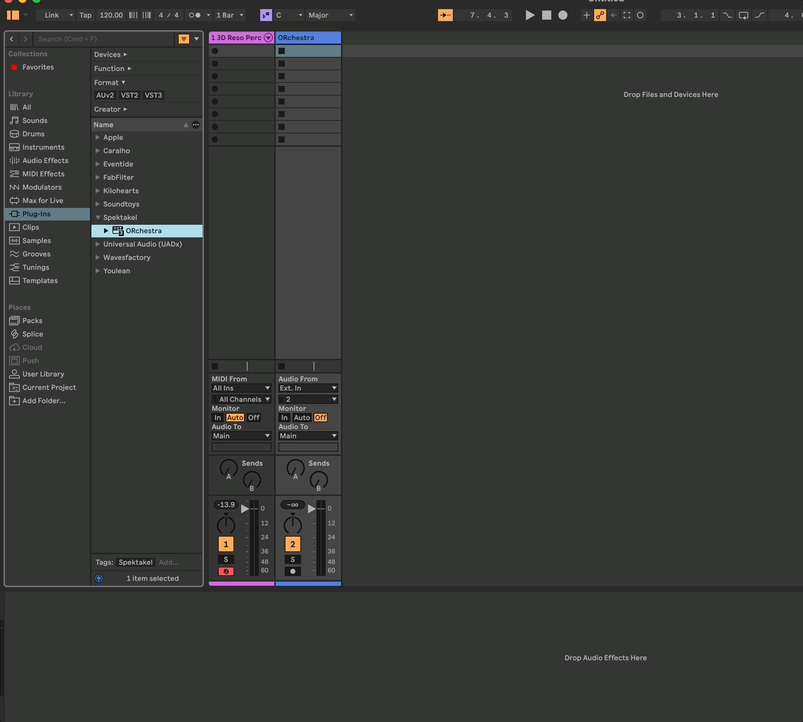
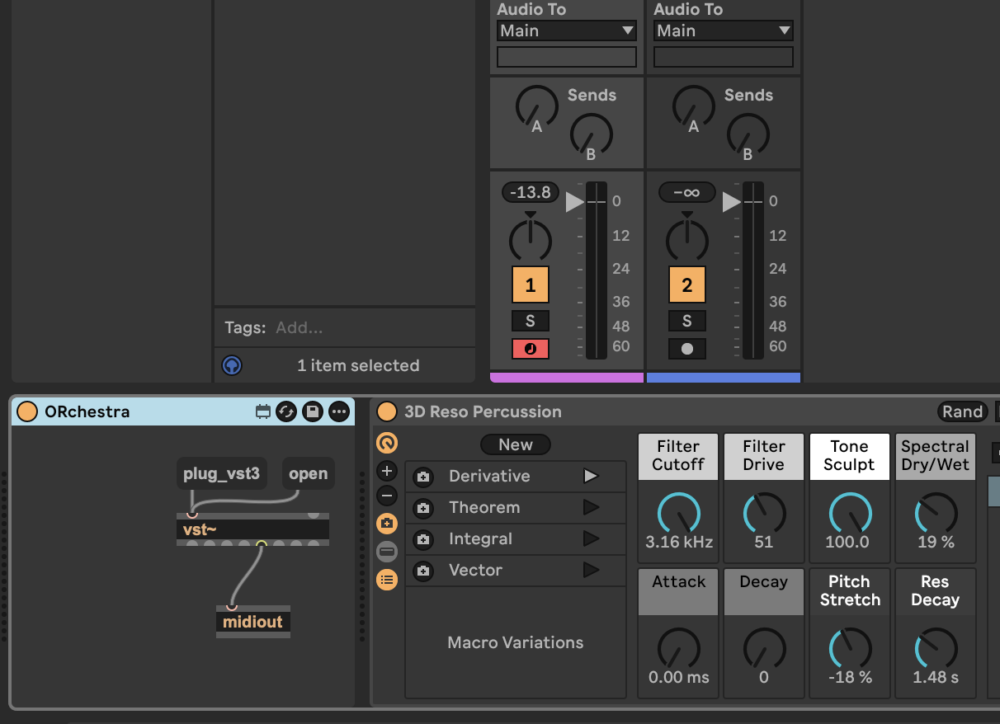
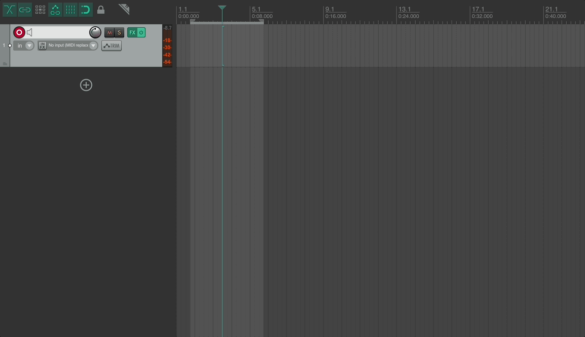
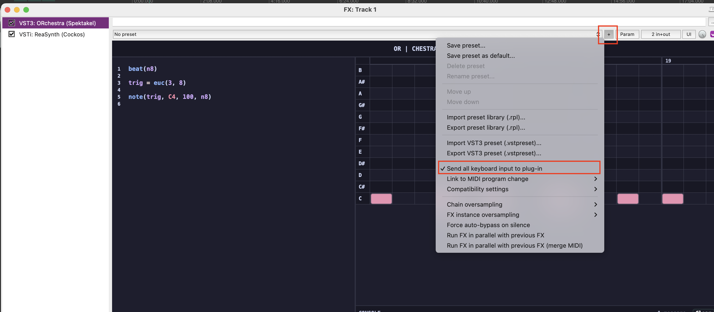
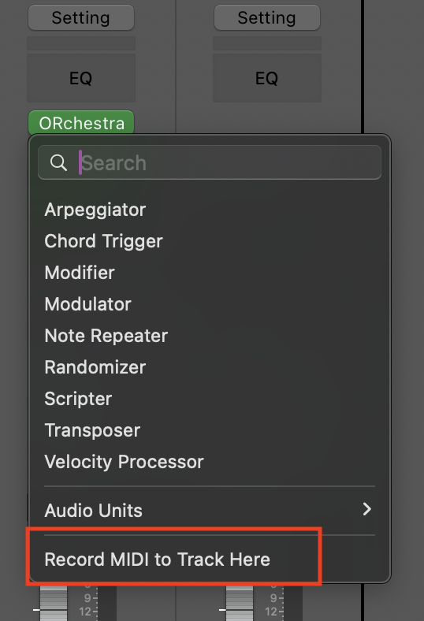

# Usage

## Setup as plugin in Major DAWs

Once ORchestra is built or installed as a plugin, adding it to a project and routing MIDI differs slightly from DAW to DAW. The notes below cover the most common hosts to get you sequencing quickly.
Unfortunately VST3 doesn't really support midi effects so for some VST DAWs there's some workarounds neeeded in order to route MIDI to the desired tracks.
The DAWs below are the ones I have managed to test for myself. If you experience issues please submit an issue on Github and I'll help resolving it. Following the steps of the other DAWs might give you ideas on how to solve the issue. 

### Ableton Live

Because of the missing options for midi plugins in Ableton Live, you'd have to do one of two work arounds to get it to work.
Option one is to place ORchestra on a audio track as an audio effect. Then on your instrument track, choose midi in from the Audio Track where you have the instance of ORchestra runnning. This will take the midi out from ORchestra and route it to your instrument track. 

Option two is to create a Max4Live device with midi out, you can use the instrument template. use the VST~ object and load ORchestra inside it, and route the midi out from VST~ to the output of the max patch. This should allow you to place the Max4Live patch before an instrument in Live, and have ORchestra be on the same track as your instrument. There will be a packaged Max4Live patch later when I get around to add it. 

### Reaper 

In order to have ORchestra send midi to a plug-in and also be able to record the midi, click the *in FX* button on a track, and click *Add, and search for ORchestra. Then add a synth of your choice in the *FX* section and it should receive midi from ORchestra. You can also add it in the *FX* section but then it will not record the midi to the track.

An important not in order to be allowed to use the space bar in the code editor is to send all keyboard commands to ORchestra. You enable this by clicking the *+* icon in the top next to Params, then select *"Send all keyboard input to plug-in"*. 

### Logic Pro X

Logic Pro and Audio Units (AU) supports midi plugins. Simply put ORchestra as a midi plugin at the top of a instrument track.
Make sure to enable the midi recording after ORchestra, by left-clicking under ORchestra in the midi effect plugin list and set "Record MIDI to Track Here"  

## Getting Started

Once you have ORchestra setup and you can open the window, there will already be a default patch ready for you. All you need to do is play in your DAW. You can use the *Play/Stop* button to run ORchestra without running the whole DAW sessions, but it will always sync to the DAWs playhead. Every time you edit the script inside you will need to press the *Compile* button in order to update the running script. To get you started quickly you can try editing the line with `trig = euc(3,8)` to `trig = euc(5,8)` and hear the rhytm change. Or edit the note function to send a different note like `note(trig, F#4, 100, n8)` instead to send a F# instead of a C.

All code in ORchestra is saved as part of the track in your DAW, so for each instance it will be saved with your project. If you would like to save some code for later use, you can use your DAWs method for saving a preset for a plug-in. There's no internal preset handling or saving in ORchestra as of now. 

In the standalone version there's a small settings menu, accessed by clicking the 3 dots in the top right corner. Here you can choose your midi output. You can choose your *Audio Driver*, which audio driver should be used, on some systems the precision of the triggering might vary with different drivers, so if you experience sluggish triggering, try a different one. Even though ORchestra does not output any audio, it's driven by an audio loop for ensuring precise triggering.
The import and export is used to either export what is in the code editor as a .txt file, or you can important previously saved files.

Next step is to have a look at the **[Language Reference](./LanguageReference.md)** page to learn on how the scripting language works and how to get started writing your own scrips or for more examples.
